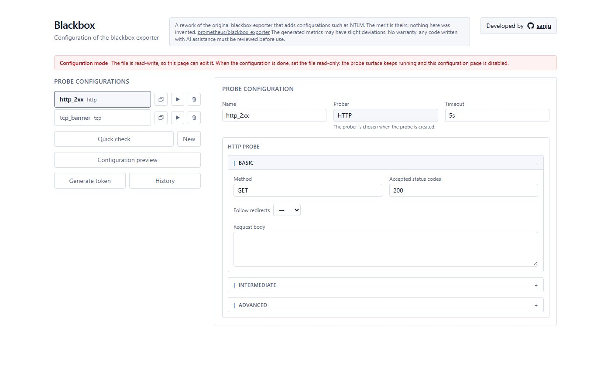

# Blackbox

Servicio independiente para las comprobaciones del
[blackbox_exporter](https://github.com/prometheus/blackbox_exporter) de Prometheus:
ejecuta las sondas él mismo, expone `/probe`, `/metrics` y `/history`, y edita su
`blackbox.yml` desde su propia interfaz web. No necesita el proceso del exportador ni
ningún otro componente: el servicio y su interfaz son el producto.



> **Aviso.** Desarrollado por **sanju**
> ([github.com/sanju-es](https://github.com/sanju-es)). Es un proyecto personal,
> entregado tal cual, sin garantía. Cualquier código escrito con ayuda de IA debe
> revisarse antes de usarlo. El autor no asume responsabilidad por su uso en
> producción ni por cualquier consecuencia derivada. Las métricas generadas pueden
> tener ligeras desviaciones.

> **Crédito.** Nada de esto está inventado. El modelo de configuración, la semántica
> de los módulos, los nombres de las métricas y el comportamiento de las sondas
> provienen del [blackbox_exporter de Prometheus](https://github.com/prometheus/blackbox_exporter)
> y de sus creadores. No es un fork ni una reescritura de su trabajo; es una interfaz
> independiente y un servicio Node que sigue su referencia, para que este despliegue
> pueda añadir la comprobación NTLM que necesita. **El mérito es suyo.**

### Qué es

Dos piezas en un mismo proceso, cada una con su responsabilidad:

- **El servicio.** Un proceso Node que posee el archivo de configuración montado, lo
  valida y ejecuta las comprobaciones él mismo: HTTP/S con autenticación Basic o NTLM,
  opciones TLS, redirecciones, códigos de estado, expresiones regulares de cuerpo y
  cabeceras; TCP con conexión y pasos `query_response`; y DNS sobre UDP, TCP o TLS.
  Sirve `/probe` a Prometheus y, con sus interruptores, `/metrics` y `/history`.
- **La interfaz web.** Una aplicación React 19 + TypeScript que lee, edita y guarda
  ese `blackbox.yml` con un formulario por prober y una vista previa YAML exacta. No
  es un editor para un exportador externo: es la consola del propio servicio, y el
  documento que produce es el que el servicio valida y ejecuta. El YAML sigue el
  formato del exportador original, así que también puede alimentar al exportador
  upstream; la excepción es NTLM, una extensión propia de este servicio.
- Un montaje de escritura sirve la página de configuración y la superficie de probe:
  `/` es la puerta del token, `/app` la interfaz, y `/probe` y `/metrics` responden
  al lado, con el token obligatorio para `/probe`. En un montaje de solo lectura `/`
  responde el aviso de escritura y el historial en texto de `/history` es opcional
  con `CHECKER_METRICS_ENABLED` y `CHECKER_HISTORY_ENABLED` (ambos `false` por
  defecto).
- Un historial de las últimas 50 ejecuciones, en memoria, una línea de texto cada
  una: `startedAt · target · module · outcome`.
- Un modal de comprobación rápida para pruebas puntuales sin escribir el archivo,
  que puede crear una configuración de probe a partir de lo probado.

Las comprobaciones siguen las métricas `probe_http_*` del exportador: fases de DNS,
conexión, TLS, espera (primer byte) y descarga, protocolo e IP y hash, versión HTTP,
longitud del contenido, versión y cifrado TLS y expiración del certificado. Las rutas
de probe reciben host, puerto y ruta; `http://` o `https://` en el destino se
rechaza. El `http.scheme` del módulo elige el esquema, con `https` para
`prober: https` y `http` en el resto.

### Imagen Docker

La imagen se construye solo desde este repositorio público: el `Dockerfile` copia la
interfaz compilada, el servicio y el modelo compartido, y nada más. Node 24 sobre
Alpine, usuario sin privilegios (`node`, uid 1000), puerto `9115`.

```bash
docker pull ghcr.io/sanju-es/blackbox-public:0.6.8
```

#### Despliegue con Docker Compose

Crea el archivo de configuración con el bloque `service` y un token de 16 a 64
caracteres sin espacios:

```yaml
service:
  token: "cambia-este-token-de-32-caracteres"

modules:
  http_2xx:
    prober: http
    timeout: 5s
    http:
      valid_status_codes: [200]
      method: GET
      follow_redirects: true
```

El `docker-compose.yml` del repositorio monta ese archivo en `/config/blackbox.yml`
en **solo lectura**, enciende `/metrics` y `/history` y reinicia el servicio si cae:

```yaml
services:
  blackbox:
    build: .
    image: ghcr.io/sanju-es/blackbox-public:${BLACKBOX_TAG:-0.6.8}
    ports:
      - '9115:9115'
    volumes:
      - ./blackbox.yml:/config/blackbox.yml:ro
    environment:
      CHECKER_METRICS_ENABLED: 'true'
      CHECKER_HISTORY_ENABLED: 'true'
    init: true
    restart: unless-stopped
```

```bash
docker compose up -d
docker compose logs -f blackbox
```

`BLACKBOX_TAG` cambia la etiqueta de la imagen; por defecto la del archivo. El
contenedor escucha en `9115` y la sonda se consulta con el token en la URL:

```
http://<host>:9115/probe?module=http_2xx&target=<host:port>&token=<token>
```

En solo lectura no hay interfaz: `/` responde el aviso de escritura, `/probe`
contesta con el token y `/metrics` y `/history` según sus interruptores. Es el modo
para un Prometheus que ya tiene su configuración versionada.

#### Prometheus

```yaml
scrape_configs:
  - job_name: blackbox
    metrics_path: /probe
    params:
      module: [http_2xx]
      token: ["cambia-este-token-de-32-caracteres"]
    static_configs:
      - targets:
          - https://example.com
    relabel_configs:
      - source_labels: [__address__]
        target_label: __param_target
      - source_labels: [__param_target]
        target_label: instance
      - target_label: __address__
        replacement: blackbox:9115
```

Cada target viaja como `?target=` y `module` y `token` son parámetros fijos del job.
`blackbox:9115` resuelve porque el servicio del compose se llama `blackbox`; si
Prometheus corre fuera de esa red, usa el host y el puerto publicados. La respuesta
es texto de Prometheus con `probe_success` y las métricas de la sonda.

Con `CHECKER_METRICS_ENABLED=true` el servicio publica además sus propios contadores
en `/metrics`, sin token; se pueden scrapear como un segundo job.

#### Editar desde la interfaz

Para usar la interfaz monta el **directorio** en escritura, no el archivo suelto: la
escritura es atómica, renombra un temporal junto al documento y un montaje de un solo
archivo falla en Docker Desktop.

```yaml
    volumes:
      - ./config:/config
```

```bash
mkdir -p config
cp examples/blackbox.yml config/blackbox.yml
docker compose up -d
```

Abre `http://<host>:9115`: la raíz es la puerta del token y, con el token correcto,
abre la interfaz en `/app`. Si el archivo no lleva token, el primer arranque genera
uno, lo escribe y sale; `restart: unless-stopped` lo levanta otra vez. En Linux, el
archivo y su carpeta deben ser escribibles por el uid 1000.

#### Sin compose

```bash
docker run -d --name blackbox --restart unless-stopped \
  -p 9115:9115 \
  -v "$PWD/blackbox.yml:/config/blackbox.yml:ro" \
  -e CHECKER_METRICS_ENABLED=true \
  -e CHECKER_HISTORY_ENABLED=true \
  ghcr.io/sanju-es/blackbox-public:0.6.8
```

El token nunca se guarda en la imagen: se lee del archivo montado y viaja en la URL
de la sonda. `docker compose build` compila la imagen desde este árbol si prefieres no
usar el registro.

### Inicio rápido

Requiere Node 24 o superior.

```bash
npm install
npm run build
CONFIG_FILE=examples/blackbox.yml PORT=9115 npm run server
```

Abre `http://localhost:9115`. Con el archivo escribible, la raíz es la puerta del
token; la interfaz vive en `/app`, y `/probe` y `/metrics` responden al lado (la
sonda necesita su token). Con el archivo de solo lectura, `/` responde el aviso de
escritura, `/probe` responde, y `/metrics` y `/history` responden solo mientras sus
interruptores estén activos. `npm run dev` arranca Vite en `5173` y hace proxy al
servicio.

### Entorno

| Variable | Por defecto | Efecto |
|---|---|---|
| `PORT` | `9115` | puerto en el que escucha el servicio |
| `CONFIG_FILE` | `/config/blackbox.yml` | archivo de configuración montado |
| `STATIC_DIR` | `dist` | interfaz compilada |
| `CHECKER_METRICS_ENABLED` | `false` | sirve `/metrics`; apagado responde `404` |
| `CHECKER_HISTORY_ENABLED` | `false` | sirve `/history` como texto; apagado responde `404` |

### Token de servicio

Un montaje escribible siempre lleva un `service.token`; cuando el archivo no tiene
ninguno, el servicio genera uno al arrancar, lo escribe y se reinicia. En un montaje
de solo lectura es opcional:

```yaml
service:
  token: "replace-with-16-to-64-characters"
```

Con él, la raíz es una pequeña página de token que entrega el valor aceptado a la
interfaz en el fragmento de la URL; `/probe` acepta `?token=...` y todas las rutas
`/api` aceptan `Authorization: Bearer ...`. El token se mantiene solo en memoria;
nunca se guarda en el navegador ni en el bundle. **Generate token**, bajo la vista
previa de configuración, lo rota y muestra el valor nuevo una vez.

### Estructura

| Ruta | Contenido |
|---|---|
| `shared/document/` | modelo YAML, parser, serializador y validación |
| `server/` | servicio de archivos, motor HTTP/S con NTLM, `/probe` y `/metrics` |
| `src/app/` | shell y puerta de modo |
| `src/features/configuration/` | módulo de configuración |
| `Dockerfile` | imagen de dos etapas, sin privilegios y con healthcheck |
| `docker-compose.yml` | arranque con el YAML montado en solo lectura |
| `.dockerignore` | contexto de compilación |

### Nota sobre NTLM

La comprobación NTLM realiza el handshake HTTP NTLM/Negotiate con `httpntlm`
vendorizado sobre la misma conexión TCP. No es un formulario de login: si el destino
pide credenciales mediante un formulario web, esta comprobación no aplica. El prober
HTTP del exportador no admite NTLM, que es la razón de existir de este proyecto.

### Proyectos originales

- [prometheus/blackbox_exporter](https://github.com/prometheus/blackbox_exporter)
- [prometheus/prometheus](https://github.com/prometheus/prometheus)

### Licencia

ISC — consulta [LICENSE](LICENSE).

Copyright (c) 2026 sanju-es.
